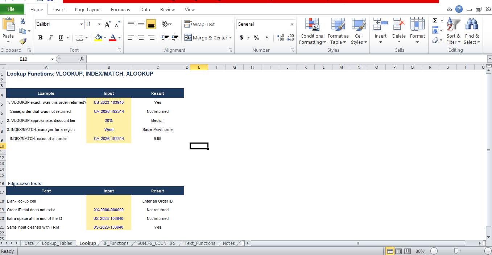

# Excel Formulas & Functions Fundamentals

## Overview
A workbook that practises everyday Excel formulas on a 300-row sample of the
Sample Superstore dataset. Each sheet covers one group of functions, with notes
on when to use each one and tests for edge cases.

## What is in each sheet

### Notes
- When to use each function, written in my own words
- Short answers to: SUMIF vs SUMIFS, XLOOKUP vs VLOOKUP, INDEX/MATCH vs VLOOKUP

### Data and Lookup_Tables
- 300 random rows from the Superstore Orders sheet
- Named ranges (Sales, Region, Category, Discount, Profit...) for readable formulas
- People, Returns and a discount tier table used by the lookups

### Lookup
- VLOOKUP exact match: was an order returned?
- VLOOKUP approximate match: discount tier
- INDEX/MATCH: manager for a region (VLOOKUP cannot look left)
- XLOOKUP: formula written as a note, as Excel 2010 cannot run it
- Edge cases: blank input, missing ID, extra space fixed with TRIM

### IF_Functions
- IF and nested IF: profit status and margin grade
- IF with AND: flags risky discounts
- Edge cases: blank cell, number stored as text (VALUE)

### SUMIFS_COUNTIFS
- SUMIF vs SUMIFS on the same question
- SUMIFS and COUNTIFS with two conditions, AVERAGEIFS
- A Region x Category sales matrix with a check against the data

### Text_Functions
- LEFT, MID, RIGHT, LEN, FIND to split Order IDs and names
- UPPER, LOWER, PROPER, TRIM, SUBSTITUTE, CONCATENATE, TEXT

## What I learned
- SUMIFS can use many conditions, SUMIF only one
- INDEX/MATCH can look to the left, VLOOKUP cannot
- A single extra space can break a lookup, so use TRIM

## Tools Used
Microsoft Excel

## Dataset
Sample Superstore Dataset

## Screenshot

